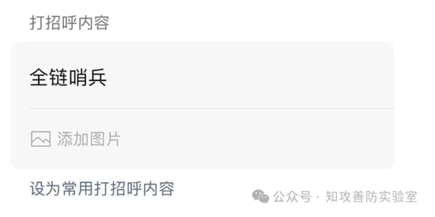

# Community and acknowledgements

[Home](../README.en.md) · [简体中文](community.md)

**Contents**

- [Full Chain Sentinel community](#section-1)
- [Acknowledgements](#section-2)

---

## Full Chain Sentinel community

When joining the group, include "全链哨兵" in your greeting.

## Acknowledgements

https://github.com/earendil-works/pi

https://github.com/ReaJason/MemShellParty
