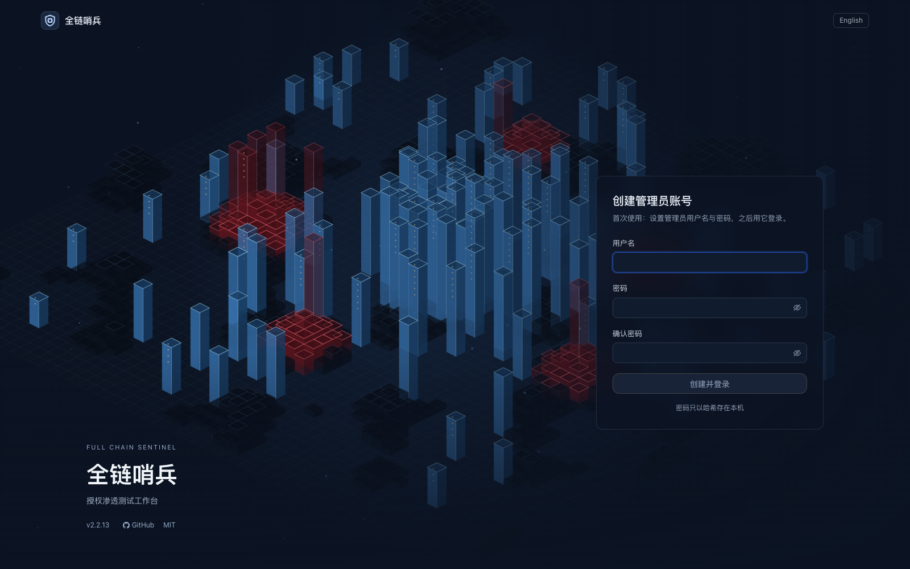
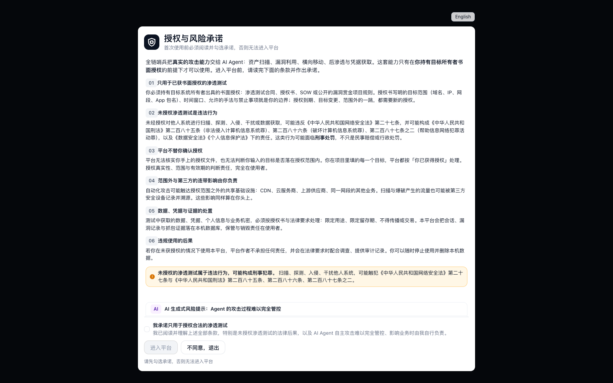
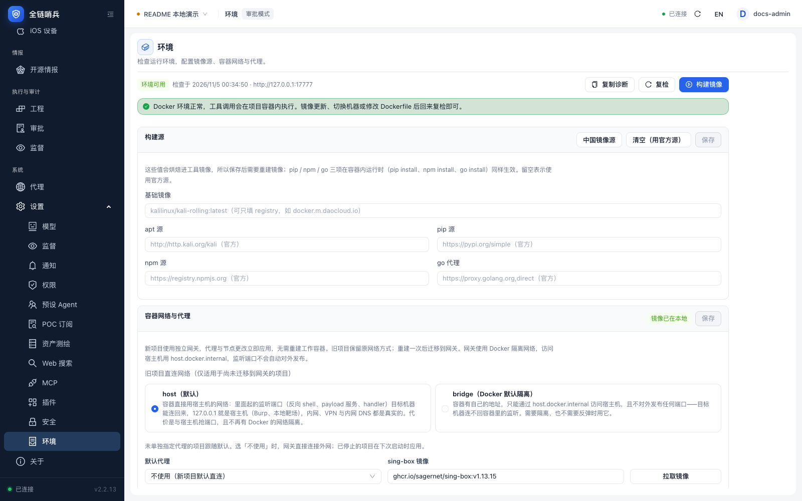

# Installation and deployment

[Home](../README.en.md) · [简体中文](deployment.md)

**Contents**

- [Release packages](#section-1)
- [From source](#section-2)
- [Startup flags](#section-3)
- [Plugin host](#section-4)
- [How to run persistently](#section-5)

---

<a id="section-1"></a>

## Release packages

Install Docker first. Docker installation itself is not covered here.

```sh
curl -fsSL https://get.docker.com -o get-docker.sh
sudo sh get-docker.sh --mirror Aliyun
```

```sh
root@VM-0-11-ubuntu:~# tar -xzvf sentinel-web-linux-x64.tar.gz
sentinel-web/
sentinel-web/sentinel-web

root@VM-0-11-ubuntu:~# cd sentinel-web/

root@VM-0-11-ubuntu:~/sentinel-web# ls
sentinel-web

root@VM-0-11-ubuntu:~/sentinel-web# chmod +x sentinel-web
root@VM-0-11-ubuntu:~/sentinel-web# ./sentinel-web

```
Windows (requires Docker Desktop; run in PowerShell):

Download `sentinel-web-windows-x64.zip` from Releases. It unpacks to the console `sentinel-web.exe` plus a `replayd/` folder (the release asset carries the platform suffix, the executable inside is `sentinel-web.exe`):

```powershell
.\sentinel-web.exe
```

`replayd/` holds the Linux binaries of the packet-replay service that the console pushes into the project containers on first use, so they must sit next to the executable (if you copy the executable elsewhere, point `SENTINEL_REPLAYD_DIR` at the `replayd/` directory). The bare `.exe` is no longer published on its own: it is just the contents of this zip, and without `replayd/` the packet-replay toolset only fails at its first use.

The executable is unsigned, so SmartScreen may block it once; choose "More info → Run anyway". Windows does not include `openssl` by default, so the first start falls back to plaintext HTTP and logs a warning. To keep HTTPS, install OpenSSL or provide certificates with `--tls-cert/--tls-key`. New projects use an isolated gateway bridge network. Container listeners are not published automatically; use `host.docker.internal` to reach the host. See [Project gateway](../packages/web/docs/project-gateway.md) (Chinese).

**Windows notes:** Linux is recommended for deployment. For HTTPS on Windows, install [Win32OpenSSL](https://slproweb.com/products/Win32OpenSSL.html) and add its binary directory to `PATH`, or provide an existing certificate and key with `--tls-cert/--tls-key`.

Console release assets: `sentinel-web-linux-x64.tar.gz`, `sentinel-web-linux-arm64.tar.gz`, `sentinel-web-darwin-arm64.tar.gz`, `sentinel-web-darwin-x64.tar.gz`, `sentinel-web-windows-x64.zip`, plus the DroidBridge APK. All five archives carry `replayd/` (linux amd64 and arm64) for the in-container packet replay.

The first run requires creating an account and password.





Make sure all testing is local or covered by proper legal penetration-testing authorization, and accept the risks of generative AI, or you cannot enter the platform.

After entering the platform, open Settings → Environment. Check Docker and the tool image; use “Build image” if the image is missing. The screenshot below shows the actual checks in the local capture environment.



Full Chain Sentinel isolates work by project. Each new project has a Kali work container and a persistent gateway. Changing proxies does not recreate either container. See [Project gateway](../packages/web/docs/project-gateway.md) (Chinese) for listener and migration limits.

<a id="section-2"></a>

## From source

Requires Node.js >= 22.19.0.

```bash
npm install --ignore-scripts
npm run build:offline  # all backend packages and coding-agent (offline; the model catalog is committed)
npm run build:web      # web console and frontend assets
npm run start:web
```

`npm run build` builds only the backend packages; the console additionally requires `npm run build:web`.

At startup the log prints the entry address, such as `https://<address>:<port>/<random-string>`. The default listener is `0.0.0.0`. The random entry string and cookie validation block scanners: requests without the entry string receive an ordinary 404, and the string changes on every start. Copy the complete address from the log.

HTTPS uses a self-signed certificate by default. On first start, the console generates one with the local `openssl` (stored under `tls/` in the configuration directory; the SAN covers localhost and all current interface IPs) and reuses it afterward. The browser will warn that the certificate is untrusted; choose "Advanced → Continue", or import `tls/cert.pem` into the system trust store. If a network change alters the LAN IP and the certificate no longer matches, reissue it with `--tls-regen`.

First-visit flow:

1. Set the console password (scrypt hash, stored in the local configuration directory).
2. Read and accept the authorized-use consent.
3. Add an endpoint (Base URL / API Key / model ID) under Settings → Models and assign the main model role.

<a id="section-3"></a>

## Startup flags

Startup flags and environment variables:

| Flag | Environment variable | Description |
| --- | --- | --- |
| `--host <address>` | `SENTINEL_HOST` | Listen address, default `0.0.0.0` |
| `--port <port>` | `SENTINEL_PORT` | Listen port, default `7777` |
| `--cwd <directory>` | `SENTINEL_CWD` | Working directory, default the current directory |
| `--gate-token <string>` | `SENTINEL_GATE_TOKEN` | Fixed entry string; random per start by default |
| `--no-gate` | — | Disable the random entry and serve from `/` (local debugging only) |
| `--no-tls` | `SENTINEL_TLS=0` | Disable HTTPS and fall back to plaintext HTTP (self-signed HTTPS is the default) |
| `--tls-cert` / `--tls-key` | — | Use the given certificate and private key (as a pair; takes precedence over auto-generation) |
| `--tls-regen` | — | Regenerate the self-signed certificate (after an IP change or a browser domain mismatch) |
| `--no-consent` | — | Skip the first-use authorization consent (automation environments) |
| `--check` | — | Run startup checks and print the report without starting the service |

<a id="section-4"></a>

## Plugin host

The plugin host is a subcommand of the same binary and has separate flags:

```sh
./sentinel-web plugin-host --local                    # default: 127.0.0.1 on a random port, auto-discovered by the console
./sentinel-web plugin-host --listen 0.0.0.0:7800      # listen externally; runs in remote mode automatically
```

| Flag | Environment variable | Description |
| --- | --- | --- |
| `--local` | — | Listen on the loopback address only (default) |
| `--listen <address:port>` | — | Listen address, for example `0.0.0.0:7800`; a non-loopback address selects remote mode |
| `--mode <local\|remote>` | — | Override the locality decision |
| `--data-dir <directory>` | `SENTINEL_PLUGIN_HOST_DIR` | Data directory, default `~/.sentinel/plugin-host` |
| `--tls-cert <pem>` / `--tls-key <pem>` | — | Provide an HTTPS certificate directly (as a pair; not allowed in local mode) |
| `--rotate-token` | — | Regenerate the access token; the old token stops working immediately |

Notes:

- Startup prints the token and data directory. The token is stored in `host.json` (0600) in the data directory and is entered when adding a remote host in the console.
- The plugin host itself serves HTTP only. The console rejects non-loopback `http://` addresses; public deployments must sit behind an HTTPS reverse proxy such as Caddy or nginx.
- `--local` is only a default. Once `--listen` is provided, the host listens on that address and infers the mode from it.
- The plugin host and the main console can run on the same machine or on different machines. A remote host cannot install plugins marked `locality: local-only`.

<a id="section-5"></a>

## How to run persistently

`screen -R sentinel` is recommended.

Then press Ctrl+A, type `d`, and detach. Learn more about screen as needed.
