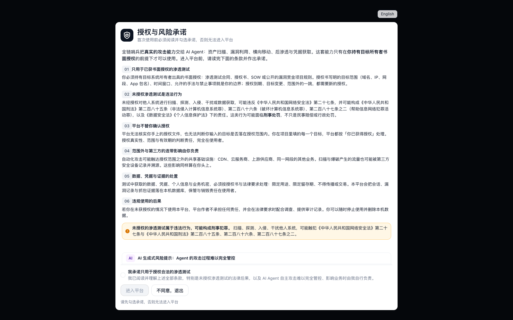
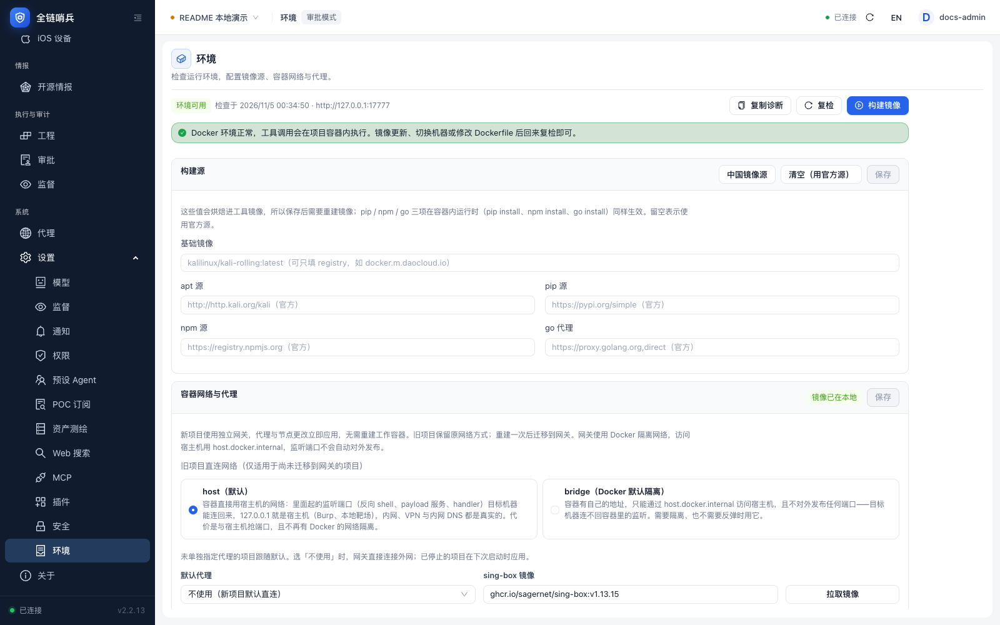

# 安装部署

[返回首页](../README.md) · [English](deployment.en.md)

**本页导航**

- [下载与启动](#section-1)
- [Windows 注意事项](#section-2)
- [从源码运行](#section-3)
- [启动参数](#section-4)
- [插件主机](#section-5)
- [如何持久化运行？](#section-6)

---

<a id="section-1"></a>

## 下载与启动

先安装并启动 Docker。Linux 可参考以下安装方式，其他系统见 [Docker 官方文档](https://docs.docker.com/get-started/get-docker/)：

```sh
curl -fsSL https://get.docker.com -o get-docker.sh
sudo sh get-docker.sh --mirror Aliyun
```

```sh
tar -xzf sentinel-web-linux-x64.tar.gz
cd sentinel-web
chmod +x sentinel-web
./sentinel-web
```
Windows（需要 Docker Desktop，PowerShell 中运行）：

在 Releases 下载 `sentinel-web-windows-x64.zip`。解压后目录里是控制台 `sentinel-web.exe` 加一个 `replayd/` 文件夹（发布资产名带平台后缀，包内的可执行文件叫 `sentinel-web.exe`）：

```powershell
.\sentinel-web.exe
```

`replayd/` 里是发包重放服务给容器用的 Linux 二进制：控制台首次在项目容器里用到「发包」时会把它下发进容器，所以要放在可执行文件旁边（把 exe 单独拷到别处时，用 `SENTINEL_REPLAYD_DIR` 指向 `replayd/` 所在目录即可）。Windows 不再单独发布裸 `.exe`：它只是这个 zip 的内容，缺了 `replayd/` 会在第一次「发包」时才报错。

该文件未签名，SmartScreen 可能拦一次，选择「更多信息 → 仍要运行」即可。Windows 默认没有 `openssl`，首次启动会回退到明文 HTTP 并在日志里提示；要保留 HTTPS，安装 OpenSSL，或用 `--tls-cert/--tls-key` 指定证书。新项目使用网关隔离网桥，容器监听端口不会自动发布，访问宿主机使用 `host.docker.internal`。详见 [项目网关](../packages/web/docs/project-gateway.md)。

控制台的 Release 资产：`sentinel-web-linux-x64.tar.gz`、`sentinel-web-linux-arm64.tar.gz`、`sentinel-web-darwin-arm64.tar.gz`、`sentinel-web-darwin-x64.tar.gz`、`sentinel-web-windows-x64.zip`，另有 DroidBridge APK。五个归档都带 `replayd/`（linux amd64/arm64），供容器内发包重放使用。

首次访问需设置账号密码。




请确保你的所有测试在本地，或者有正规合法的渗透测试授权，并且同意AI 生成式风险，否则无法进入平台。

进入平台后打开「设置 → 环境」，检查 Docker 与工具镜像；缺少镜像时点「构建镜像」。下图为本次本地截图环境的真实检查结果。



全链哨兵以项目为单位组织工作，新项目创建一个 Kali 工作容器和一个常驻网关容器。切换代理无需重建容器，入站监听与旧项目迁移限制见 [项目网关](../packages/web/docs/project-gateway.md)。

<a id="section-2"></a>

### Windows 注意事项

部署优先选择 Linux。Windows 使用 HTTPS 时，可安装 [Win32OpenSSL](https://slproweb.com/products/Win32OpenSSL.html) 并将其二进制目录加入 `PATH`，或用 `--tls-cert/--tls-key` 指定现有证书与私钥。

<a id="section-3"></a>

## 从源码运行

要求 Node.js >= 22.19.0。

```bash
npm install --ignore-scripts
npm run build:offline  # 后端各包与 coding-agent（不联网，模型目录已入库）
npm run build:web      # Web 控制台与前端资源
npm run start:web
```

`npm run build` 只构建后端各包，控制台需要额外的 `npm run build:web`。

启动后日志里会打印本次的入口地址，形如 `https://<地址>:<端口>/<随机串>`。默认监听 `0.0.0.0`，随机入口串与 cookie 校验用于挡扫描器：没有入口串的请求一律返回普通 404，入口串每次启动都变。请在日志里取完整地址访问。

默认使用自签 HTTPS：首次启动用本机 openssl 生成证书（存于配置目录 `tls/`，SAN 覆盖 localhost 与当前所有网卡 IP），之后复用。浏览器首次访问会提示证书不受信任，选择「高级 → 继续前往」即可，也可把 `tls/cert.pem` 导入系统信任。换网络后局域网 IP 变化导致证书域名不匹配时用 `--tls-regen` 重签。

首次访问的流程：

1. 设置控制台密码（scrypt 哈希，保存在本机配置目录）。
2. 阅读并勾选授权使用承诺。
3. 在「设置 → 模型」添加端点（Base URL / API Key / 模型 ID），并分配主模型角色。

<a id="section-4"></a>

## 启动参数

启动参数与环境变量：

| 参数 | 环境变量 | 说明 |
| --- | --- | --- |
| `--host <地址>` | `SENTINEL_HOST` | 监听地址，默认 `0.0.0.0` |
| `--port <端口>` | `SENTINEL_PORT` | 监听端口，默认 `7777` |
| `--cwd <目录>` | `SENTINEL_CWD` | 工作目录，默认当前目录 |
| `--gate-token <串>` | `SENTINEL_GATE_TOKEN` | 固定入口串，默认每次启动随机 |
| `--no-gate` | — | 关闭随机入口，直接以 `/` 提供服务（仅本机调试） |
| `--no-tls` | `SENTINEL_TLS=0` | 关闭 HTTPS，退回明文 HTTP（默认自签 HTTPS） |
| `--tls-cert` / `--tls-key` | — | 使用指定证书与私钥（成对使用，优先于自动生成） |
| `--tls-regen` | — | 重新生成自签证书（本机 IP 变化、浏览器报域名不匹配时用） |
| `--no-consent` | — | 跳过首次授权承诺（自动化环境） |
| `--check` | — | 只做启动前自检并打印报告，不启动服务 |

<a id="section-5"></a>

## 插件主机

插件主机是同一个二进制的子命令，参数与主服务分开：

```sh
./sentinel-web plugin-host --local                    # 默认，127.0.0.1 随机端口，控制台自动发现
./sentinel-web plugin-host --listen 0.0.0.0:7800      # 对外监听，自动按 remote 模式运行
```

| 参数 | 环境变量 | 说明 |
| --- | --- | --- |
| `--local` | — | 只监听回环地址（默认） |
| `--listen <地址:端口>` | — | 监听地址，例如 `0.0.0.0:7800`；非回环地址自动判定为 remote |
| `--mode <local\|remote>` | — | 覆盖 locality 判定 |
| `--data-dir <目录>` | `SENTINEL_PLUGIN_HOST_DIR` | 数据目录，默认 `~/.sentinel/plugin-host` |
| `--tls-cert <pem>` / `--tls-key <pem>` | — | 直接提供 HTTPS 证书（成对使用；本地模式不允许） |
| `--rotate-token` | — | 重新生成访问 token，旧 token 立即失效 |

说明：

- 启动时会打印 token 与数据目录；token 存在数据目录的 `host.json`（0600），控制台添加远端主机时填它。
- 插件主机自身只提供 HTTP；控制台拒绝非回环的 `http://` 地址，公网部署要放在 Caddy/nginx 的 HTTPS 反代后面。
- `--local` 只是默认值；一旦给了 `--listen`，就按 `--listen` 的地址监听并据此推断模式。
- 插件主机与主控制台可以同机，也可以分开；远端主机不能安装 `locality: local-only` 的插件。

<a id="section-6"></a>

## 如何持久化运行？

在终端运行 `screen -R sentinel`，然后在该会话中启动 `./sentinel-web`。

按 `Ctrl+A`，再按 `D` 脱离会话，进程继续运行。再次执行 `screen -R sentinel` 可回到会话。
