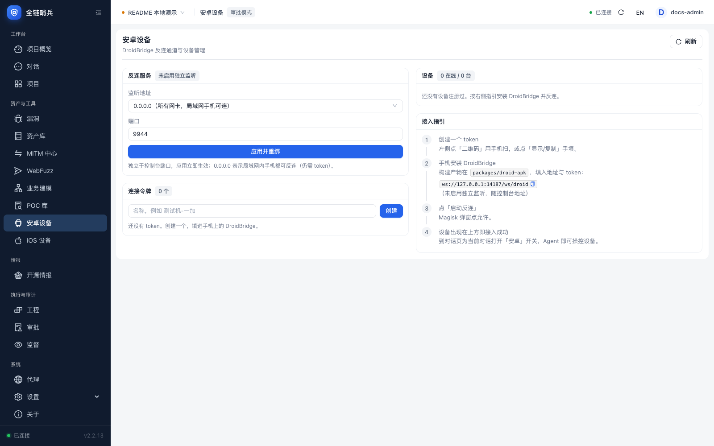
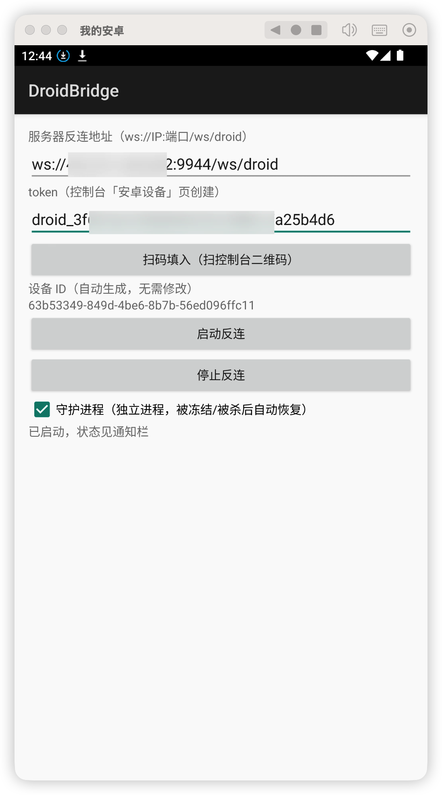
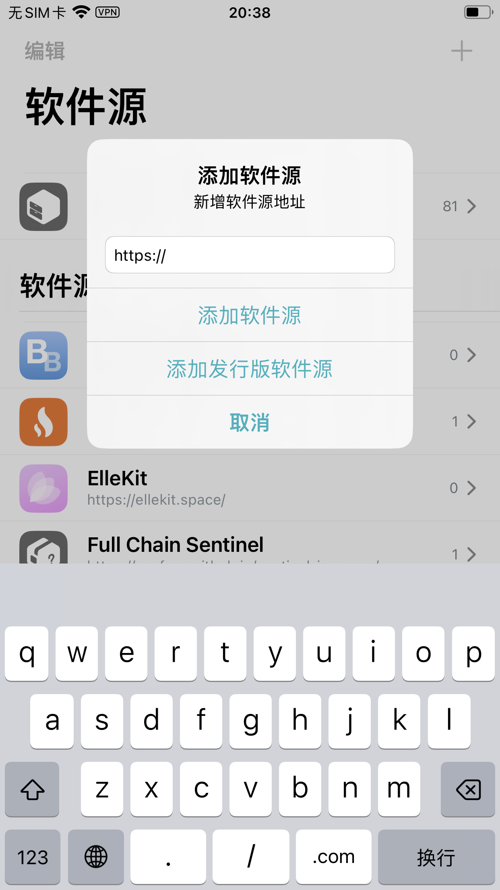
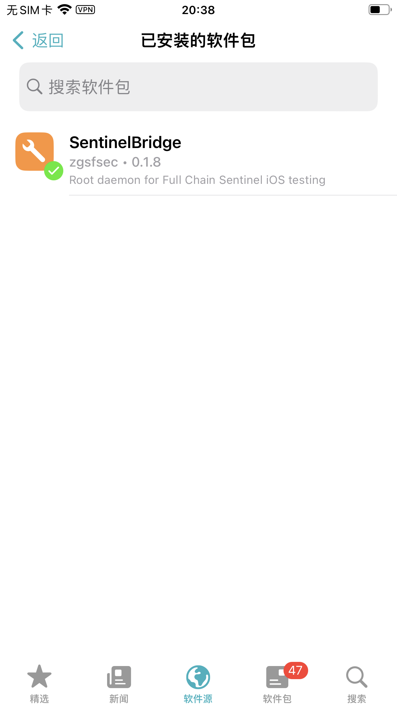
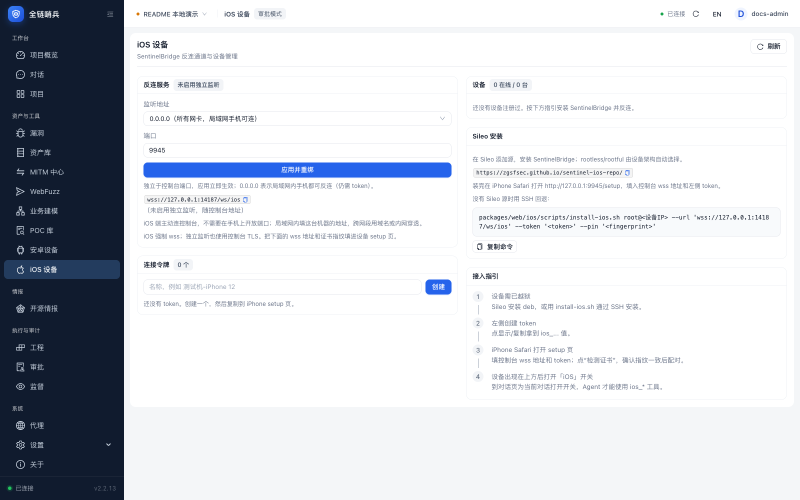
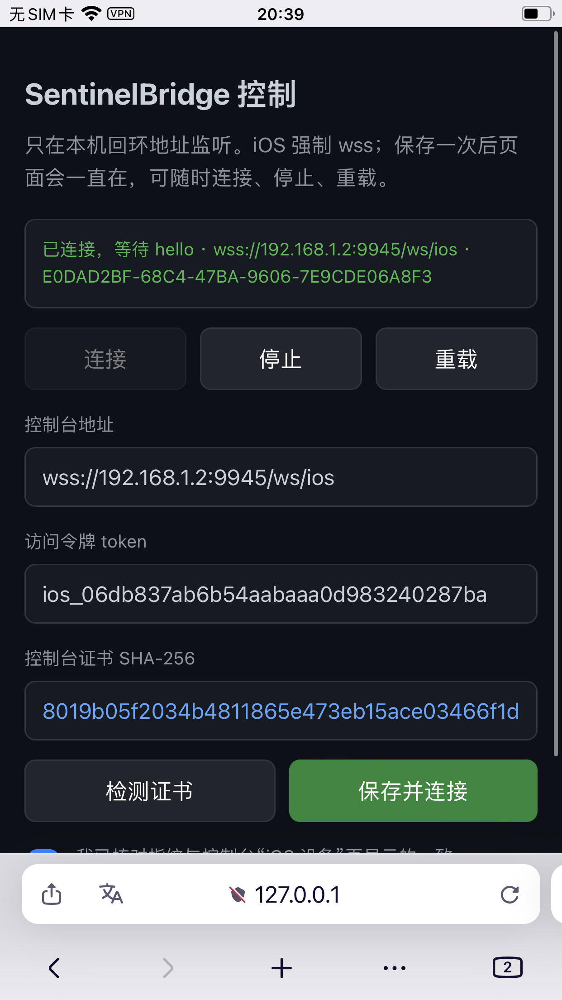

# Android and iOS setup

[Home](../README.en.md) · [简体中文](mobile.md)

**Contents**

- [Android setup](#section-1)
- [iOS security](#section-2)

---

<a id="section-1"></a>

## Android setup

You need a rooted device (a virtual machine is also fine) with the companion app installed.



Rooting the phone is outside the scope of this document; the Coolapk community is a good place to learn more. The Android device is the primary reverse-connection platform, so you can deploy the main program on a public server.



<a id="section-2"></a>

## iOS security

iOS support is still under development and testing. Do not use it without some iOS security fundamentals; issues and pull requests are welcome.

You need a jailbroken iPhone with Sileo installed.

Add the package source (use the lowercase repository URL):

```text
https://zgsfsec.github.io/sentinel-ios-repo/
```





Then open the following address in Safari on the iPhone:

```text
http://127.0.0.1:9945/setup
```



Create a token on the console's iOS devices page, enter the console wss URL and the token, verify the certificate fingerprint, and save. The local control page stays available and can connect, stop, or reload the bridge at any time.



See also: [iOS implementation](../packages/web/ios/README.md) · [iOS QA](ios-agent-qa.md).
