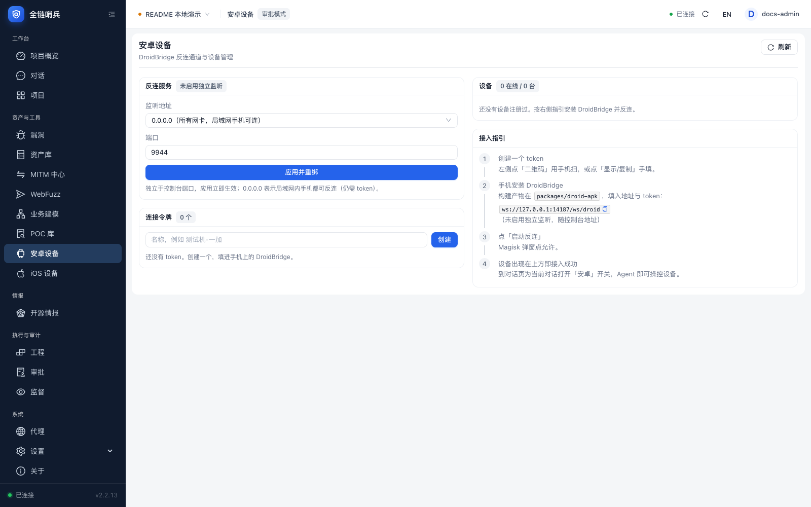
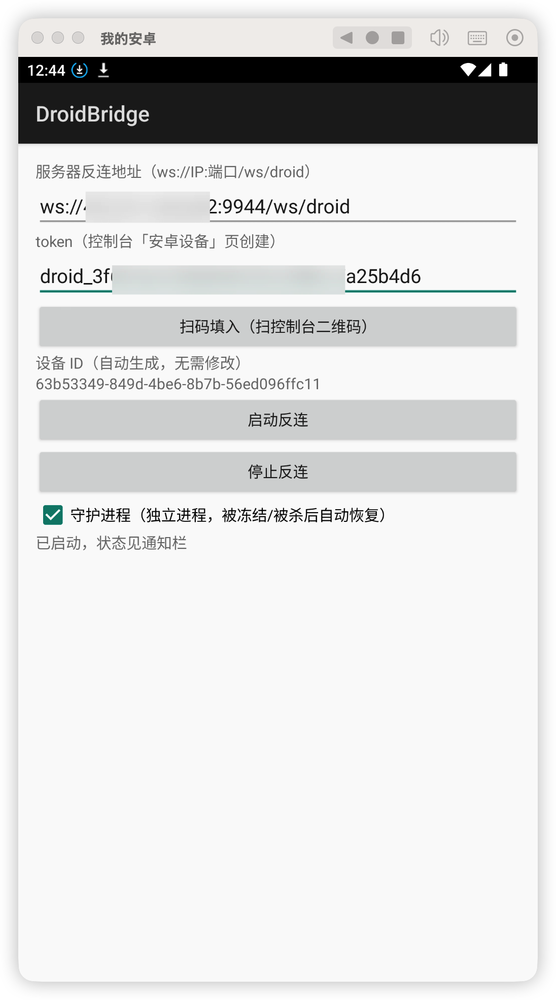
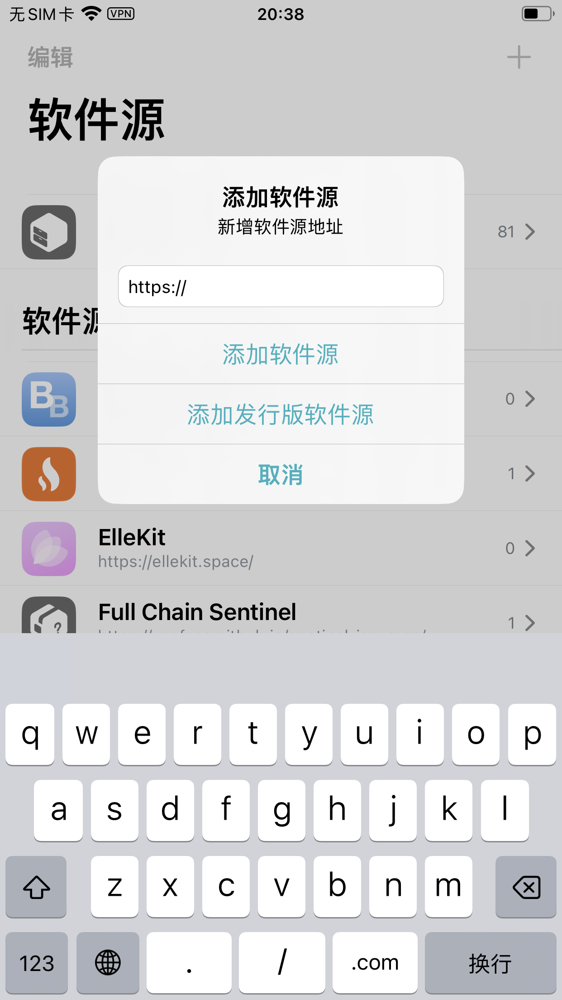
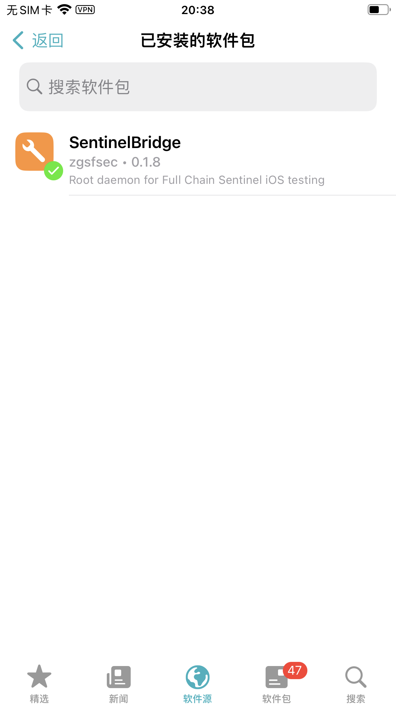
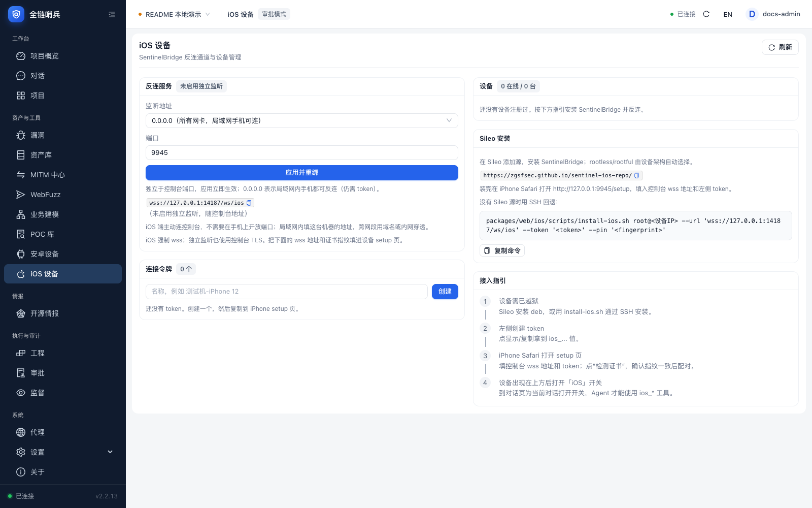
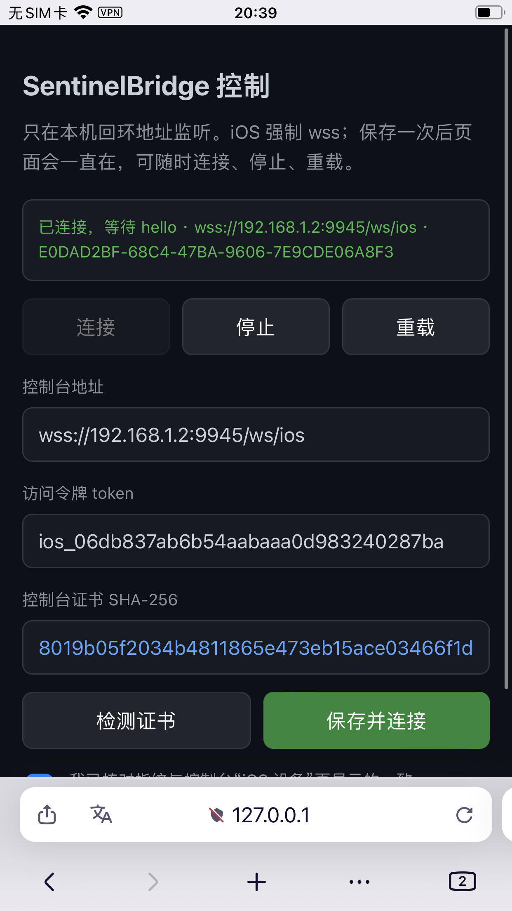

# 安卓与 iOS 接入

[返回首页](../README.md) · [English](mobile.en.md)

**本页导航**

- [关于安卓配置](#section-1)
- [关于 iOS 安全](#section-2)

---

<a id="section-1"></a>

## 关于安卓配置

你需要有一台 root 后的设备（虚拟机亦可），并且安装配套的 app 即可



关于手机 root，这里就不再讲解，有兴趣可以去酷安社区逛逛,安卓机为反连主平台，所以你可以将主程序部署在公网服务器。



<a id="section-2"></a>

## 关于 iOS 安全

首先如果你没有一些 iOS 安全相关的基础知识，不建议使用这个功能。该功能还在开发测试阶段，欢迎提交 issue。

首先需要一台越狱后的机器，并安装 Sileo。

添加软件源（必须使用小写仓库地址）：

```text
https://zgsfsec.github.io/sentinel-ios-repo/
```





然后在 iPhone 的 Safari 打开：

```text
http://127.0.0.1:9945/setup
```



在控制台「iOS 设备」页创建 token，填入控制台 wss 地址、token，检测并核对证书指纹后保存。控制页会常驻，可随时连接、停止和重载。



补充文档：[iOS 构建与实现](../packages/web/ios/README.md) · [iOS 测试清单](ios-agent-qa.md)。
