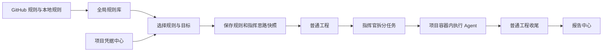

# 安全检查：设计方案

本文记录已确认的产品设计。实现与使用说明见 [安全检查](security-checks.md)。

## 1. 已确认的范围

| 项目 | 决策 |
| --- | --- |
| 入口 | 工程内增加“工程列表 / 安全检查”页签；安全检查首页展示检查任务，新建时选择规则 |
| 类别 | 支持多级分类；一条规则可归属多个分类路径，以逗号分隔，等保、数据安全等内容由后续规则逐步完善 |
| 规则 | Markdown 文件头元数据 + 自由文本提示词，不要求结构化检查项 |
| 规则库 | 全局共享，支持官方和用户自定义 GitHub 仓库，以及本地自定义规则 |
| 官方仓库 | `https://github.com/zgsfsec/Full-Chain-Sentinel-System` |
| 同步 | 手动同步，并默认每天自动同步；失败保留已有规则 |
| 编辑 | 同步规则只读；复制为本地自定义规则后编辑，不被同步覆盖 |
| 提交 | 勾选多条规则，合并创建一个普通工程 |
| 指挥思路 | 强制采用内置“安全检查”；页面无选择项，服务端固定思路及其快照 |
| 目标 | 手动填写或从当前项目凭据中心选择，可混合；凭据不是必选项 |
| 凭据状态 | 允许选择任意状态；未验证或验证失败的凭据先由 Agent 验证并上报，再用于检查 |
| 凭据范围 | 安全检查工程允许访问其所属项目的全部凭据，不局限于页面勾选记录 |
| 报告 | 沿用普通工程，由 Agent 自主组织报告，通过现有流程归档报告中心 |

勾选凭据用于确定本轮检查目标；工程访问其他项目内凭据用于完成这些目标的检查，不代表项目内其他主机自动成为检查目标。

## 2. 页面与提交流程

工程首页保留“工程列表”和“安全检查”两个入口，进入具体工程后继续使用现有工程看板。

安全检查首页展示当前项目的检查任务列表。点击「新建检查」后，第一步选择规则，布局如下：

```text
新建检查       选择规则 → 输入目标 → 关联凭据中心 → 执行配置

规则库 | 已选规则                              规则管理
┌────────────────┬──────────────────────────────────────────┐
│ 搜索分类       │ 搜索规则                 来源筛选         │
│ 全部规则       │ □ 名称       分类       来源       操作  │
│ 等保           │ □ Linux…     等保/…     官方       查看  │
│   三级         │ □ 数据库…    数据安全   自定义     编辑  │
│     Linux      │                                          │
│ 数据安全       │ 分页                                     │
│ 用户自定义分类 │ 已选 2 条规则                下一步      │
└────────────────┴──────────────────────────────────────────┘
```

列表采用全站单行紧凑表格，长内容省略并可查看完整值。树节点只负责筛选，不为每个类别新建页面或页签。来源与分类独立，例如自定义规则也可以放在“等保/三级/Linux”。

跨分类、跨页保留已选规则，显示已选数量，可批量选中筛选结果、切换已选视图、移除和清空。规则详情通过抽屉展示完整提示词、来源、版本、复制及选用入口。窄屏默认折叠分类树，表格允许横向滚动。

“规则源”在抽屉内配置仓库、分支、目录、同步开关和周期，展示最近同步时间、结果及错误。“同步规则”立即同步已启用规则源，不触发工程执行。

点击任务列表的“新建检查”，进入复用现有工程设置的向导：

1. 选择规则，支持跨分类多选。
2. 填写检查名称和目标、上传附件，可补充本次检查要求；只选凭据目标时可先留空目标。
3. 关联凭据中心：直接在页面内勾选当前项目凭据，支持搜索、类型和验证状态筛选、筛选结果批量选中和已选视图，也可跳过。列表脱敏，展示类型、目标、端口、账号及验证状态。
4. 配置预设 Agent、并发、轮次、Token 限额、执行模式与计划，沿用现有默认值和校验；不提供指挥思路选择。确认项目、规则、目标及凭据访问范围后提交，打开普通工程看板，返回时回到检查任务列表。

任务列表另设“检查规则”维护入口，无需先创建检查即可维护规则与规则源。

凭据选择器只显示当前项目内容，未验证和验证失败的记录也允许选择。相同目标可能有多个账号、数据库或实例，应保留全部凭据引用，不能仅按 IP 去重丢失认证上下文。

至少提供一个目标或一段明确的检查任务说明；没有凭据不阻止提交。规则库可在未选项目时浏览和编辑，创建工程必须有项目。

## 3. 规则文件与来源

建议在官方仓库新增 `rules/security-checks/` 目录，默认分支配置为 `main`。本地 `origin/HEAD` 当前指向 `main`；本次 GitHub API 请求返回 403，未确认远端是否已有其他规则目录。目录和分支均应可配置。

文件示例仅说明格式，不作为已完善的等保测评规则：

```markdown
---
id: linux-account-check
name: Linux 账号安全检查
category: 等保/三级/Linux,主机安全/账号
description: 检查账号、认证与权限配置
---

围绕用户指定的 Linux 主机开展账号安全检查。
结合实际系统、账号权限和能够取得的配置，自主组织检查步骤。
说明发现的问题、判断依据、无法检查的原因及整改建议。
```

`id`、`name`、`category` 必填，`description` 可选，正文必须非空。多个分类路径用逗号分隔，分类内部使用 `/` 分隔层级；一条规则可同时出现在多个分类下，同一分类内按 ID 去重计数。不直接用于拼接本地文件路径。文件移动或分类调整不改变 ID。

全局唯一引用采用“规则源 ID + 规则 ID”，避免不同仓库相同 ID 互相覆盖。本地自定义规则使用独立来源。规则版本由规范化内容摘要标识，并记录仓库提交 SHA 和文件路径，不要求维护者手动修改版本号。

页面支持创建、编辑、删除本地规则，填写分类路径即可新增类别。复制同步规则时生成新的本地 ID，同时保留原规则及版本的来源信息。

首版实现规则机制、格式示例和贡献文档，不预设已经覆盖完整等保或数据安全标准。后续扩展内容主要通过增补 Markdown 完成。

## 4. 同步行为

官方规则源默认指向主仓库，允许增加其他 GitHub 仓库并分别配置分支和目录。同步任务只下载、校验和保存 Markdown 规则，不运行仓库脚本。

同步一次固定到同一个提交 SHA，避免目录枚举与文件下载期间分支更新导致混合版本。仅处理指定目录内的规则文件，设置下载大小、文件数量、单文件长度与超时上限。下载链路需明确采用全局规则源的网络配置，不能随当前查看项目变化。

每个来源先在临时区下载、完整校验，再通过事务切换该来源的可用版本。同一来源重复 ID、无效文件头或正文缺失等错误导致本轮不更新，并展示具体文件及原因。不同来源独立结算，某个来源失败不影响其他来源。

规则源记录最后检查时间、最后成功时间、下一次同步时间、提交 SHA、更新数量及错误。支持条件请求或比较 SHA，无变化时不重复写入。

默认每 24 小时同步一次，可关闭或调整。调度以持久化时间为依据，服务重启后补做一次到期同步；同一来源不并发同步。失败采用有上限的退避重试，避免每个调度周期重复请求。

同步失败继续使用最近成功版本。来源中移除的规则从新工程选择列表下架；历史工程使用自己的快照。本地副本不受影响。删除来源前显示影响范围，删除来源不删除工程或报告。

后续实现时验证 GitHub API 限流及访问受限场景，提供明确错误；保留可配置镜像或离线导入的扩展点，首版不增加新的云端服务依赖。

## 5. 普通工程集成

复用现有 `EngineManager.createEngine(project, input, submission)`。安全检查模块只负责管理规则、组装输入和提交，不另建调度器、执行会话或工程状态机。



新增内置“安全检查”指挥思路，仍由 `doctrines.ts` 统一管理。它负责理解检查目标、选用规则、派发任务和汇总报告；具体等保、数据安全等内容保存在规则库，不为每条规则生成一条指挥思路。

所选规则为指挥官的本轮检查要求，执行 Agent 获得相关规则文本或可读取的快照路径。大量规则按需读取，不在每个任务中重复注入全部规则。需区分操作员选定的检查指令与目标、附件等外部数据，调整现有提交输入说明，避免把规则提示词一概当作不可信数据忽略。

提交元数据使用 `source=security-check` 和客户端稳定请求 ID，同一提交重试返回同一个工程。请求 ID 绑定项目和内容摘要，不同内容复用同一 ID 时拒绝，避免重复工程或错误复用。

工程快照保存：规则 ID、来源、版本、正文，内置安全检查指挥思路完整内容，目标、凭据引用、补充要求和凭据能力授权。复用 `engine_submissions` 保存快照；现有工程参数仍由工程记录保存。规则更新、删除或来源停用不改变已提交工程，暂停恢复与服务重启也使用原快照。规则和凭据刷新不会自动替换已选版本，更新或删除时提示用户确认后采用当前内容。

输入 JSON 和工程快照均不复制密码、私钥或 Token。凭据引用携带 ID 和提交时版本用于追溯，但实际读取始终读取当前版本；认证信息发生变化时遵循凭据中心的重新验证规则，不悄悄使用已失效的秘密。

工程列表可显示“安全检查”来源标签并提供筛选；执行日志、任务、续跑、暂停、恢复、终止、调度限制及删除行为全部沿用普通工程。报告通过 `engine_done → archiveReport → 报告中心` 归档，不增加逐项结果表或专属报告系统。

## 6. 凭据能力

当前 `TaskSessionOptions` 没有凭据能力，`sentinel-session.ts` 对任务会话关闭凭据工具。需要在普通工程接口中增加显式、持久化的凭据能力配置，例如 `credentials: { scope: "project" }`，由工程传给任务会话。

授权由服务端的工程记录确定，不接受模型通过提示词或工具参数扩大范围。安全检查工程启用该能力，普通工程默认行为保持不变；不通过判断工程名称或指挥思路名称来授予权限。

指挥官通过脱敏目录了解当前项目凭据；执行 Agent 复用 `credential_list`、`credential_read`、`credential_save`、`credential_report_validation` 及既有工具指引。凭据工具始终绑定工程所属项目，用户切换正在查看的项目不改变绑定。新增或修改凭据继续遵循现有状态和版本规则。

工程拥有项目范围权限，页面勾选记录不是读取白名单。没有勾选凭据也可提交，Agent 仅在任务需要时查找相关凭据。项目范围表示可访问当前项目现存及后续新增的凭据，不授予其他项目权限，也不自动扩大检查目标。

验证流程复用既有规则：未验证或失败记录先按 `purpose=verify` 读取、实际验证、上报当前版本；成功后按 `purpose=use` 使用。认证拒绝与网络、工具、协议异常区分处理，无法确认时保留原状态。不同任务并发读取、确认和更新时，旧验证结果不能覆盖新版本或用户确认。

任务暂停恢复、继续或重建会话时从工程配置重建权限，但不恢复已经失效的验证读取令牌；上报前重新读取当前版本。首版通过普通工程执行 Agent 完成工作，不为安全检查额外引入子代理权限传播。

凭据验证历史继续记录来源会话与凭据版本；任务会话可沿用已有工程、任务关联追溯。报告和指挥官任务摘要不包含认证秘密。工具返回的明文仍会进入执行 Agent 的模型上下文及会话记录，沿用现有凭据中心的数据边界。

## 7. 存储及模块边界

建议新增全局 `security-checks.db`，与项目执行数据分离：

| 数据 | 保存内容 |
| --- | --- |
| 规则源 | 仓库、分支、目录、启用状态、周期、同步状态 |
| 规则 | 来源 ID、规则 ID、名称、分类、简介、正文、版本、来源提交与路径 |
| 同步记录 | 时间、结果、变化数量及错误，数量有上限 |
| 工程提交 | 复用 `engine_submissions` 的来源、幂等键、指挥思路及规则快照 |
| 凭据 | 继续由 `credentials.db` 加密保存，不在规则库保存秘密 |

类别树从有效规则的分类路径生成，避免维护重复的树结构。删除项目只清理其工程及相关项目数据，保留全局规则库；删除全局规则不影响已有工程快照。

建议模块划分：

| 模块 | 职责 |
| --- | --- |
| `security-check-types.ts` / `security-check-input.ts` | 类型、Markdown 解析及输入校验 |
| `security-check-store.ts` | 规则源、规则、本地编辑与同步状态的事务存储 |
| `security-check-sync.ts` | GitHub 下载、版本定位、调度及失败恢复 |
| `security-checks.ts` | 管理接口与普通工程提交桥接 |
| `SecurityChecksPage.tsx` | 分类树、列表、详情、选择和提交 |
| 现有工程模块 | 工程来源显示、快照和凭据能力传递 |
| 现有凭据模块 | 复用工具，支持受工程配置控制的任务会话 |

不依赖代理订阅的节点解析，不把规则同步塞入 `poc-subscriptions.ts`，但复用已有网络、SQLite 和调度实践。未来其他工程入口可复用工程快照及凭据能力，无需照搬安全检查业务。

## 8. 实施顺序与验收

1. 定义 Markdown 格式、示例及贡献说明，实现规则存储、本地编辑和来源区分。
2. 实现固定版本同步、手动同步、默认每日调度及错误展示。
3. 扩展通用工程凭据能力和任务会话，验证项目隔离、版本校验及恢复。
4. 实现工程内页签、分类树、单行表格、规则详情和提交向导，复用已有工程设置。
5. 接入 `EngineSubmission`、内置“安全检查”指挥思路与报告归档，完成联动验证。

关键验收：

- 多级分类、搜索和跨页多选能支撑大量规则；所有规则内容仍是自由文本。
- 多个来源同名或同 ID 规则互不覆盖；复制后的自定义规则不会被同步改写。
- 同步失败、无变化、目录为空、重复 ID、远端删除、调度重启均有确定行为。
- 多规则只创建一个普通工程，重复提交不重复创建；输入快照不随规则库变化。
- 手动目标、仅选凭据、混合目标和不选凭据均能使用；凭据引用不因目标去重丢失。
- 工程 Agent 能读取所属项目全部凭据，不能跨项目；后台执行和恢复不跟随当前查看项目。
- 未验证凭据先验证再使用；旧结果不能覆盖更新后的凭据或用户确认。
- 工程继续使用普通任务、限制、暂停恢复和报告中心，不新增第二套执行或结果体系。

实现时按仓库要求运行 `npm run check` 和本次修改涉及的指定测试，不调用真实模型验证凭据，不依赖付费接口或真实客户主机。
