# Usage guide

[Home](../README.en.md) · [简体中文](usage.md)

Screenshots use the current console in a separate local project; empty records and disconnected devices show the actual state. See [capture details](../images/screenshots/README.md).

**Contents**

- [What does "full chain" mean?](#section-1)
- [Usage](#section-2)
- [Engagement mode](#section-3)
- [Approval](#section-4)
- [POC feeds](#section-5)
- [Plugin center](#section-6)
- [How to use it](#section-7)
- [How to develop plugins](#section-8)
- [MITM and WebFuzz](#section-9)
- [Open-source intelligence](#section-10)
- [Models, supervision, and files](#section-11)

---

<a id="section-1"></a>

## What does "full chain" mean?

The platform covers Web, mini-program, and app testing. These clients run in different environments, but share a project for mapping APIs, testing backends, and recording assets and findings. Mobile testing also provides device analysis tools.

<a id="section-2"></a>

## Usage

Create a project before using the console; otherwise it cannot be used.
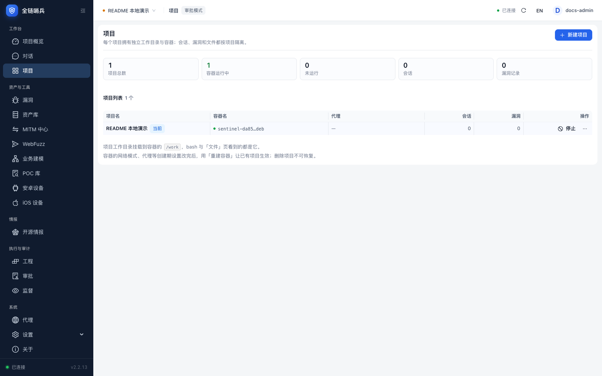

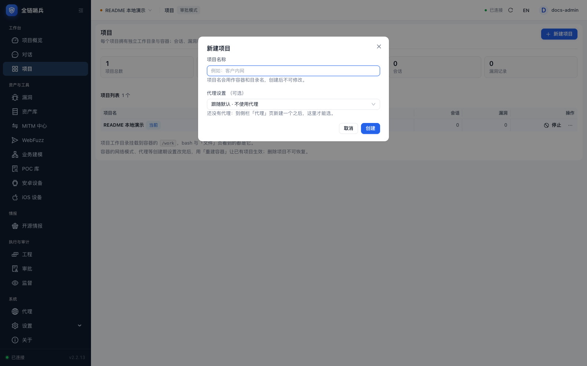

A few common scenarios:

1. **Web testing**
   Use the input box directly.

2. **Mini-programs**
   Select a preset agent, decompile the WeChat mini-program with a tool such as Tscan, and upload the result with the attachment control at the lower left.

3. **Apps**
   Configure your Android device under Android devices in the left sidebar, install the target app on the device, and select "Android" in that conversation's chat box. The toggle is per conversation: enabling it in one chat does not mount Android tools in another.

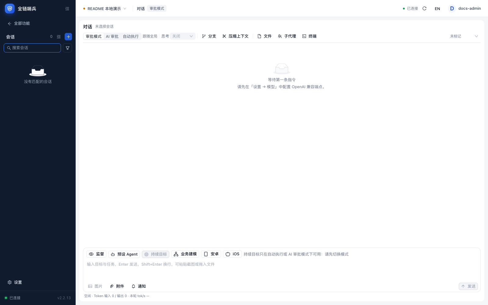

The design goal is to use fewer tools and less context. If you do not enable the "Android" toggle for a conversation, Android-related tool calls and prompts are not inserted there.

<a id="section-3"></a>

## Engagement mode

For batch testing. It uses a commander architecture for multi-task orchestration and is still experimental; try it at your own risk.

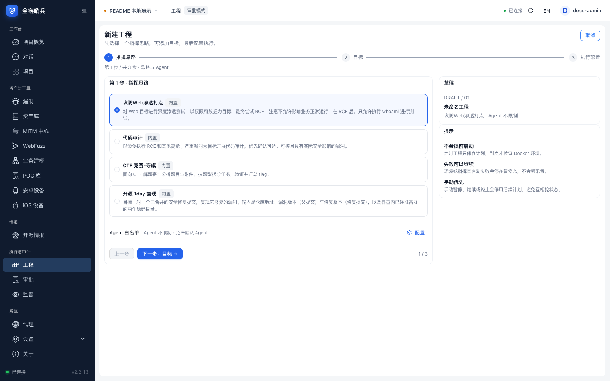

<a id="section-4"></a>

## Approval

Assign the Gatekeeper role under Settings → Models, using an endpoint with sufficient request capacity. AI Approval judges supported calls; failures and timeouts allow execution. See [security boundaries](security.en.md#section-2) for coverage.

The "Approval" item in the sidebar has two tabs. "AI Approval" is the Gatekeeper decision log (verdict, reason, duration, model). "Auto Approval" is the log of calls that no one judged: Auto mode, manual allow/block in Approval mode, and tools not covered by the Gatekeeper (read / edit / write, or when the MCP switch is off). Every bash, MCP, and plugin call leaves one record. Together the two tabs cover every call exactly once and support filtering by project, session, source, time, and keyword.

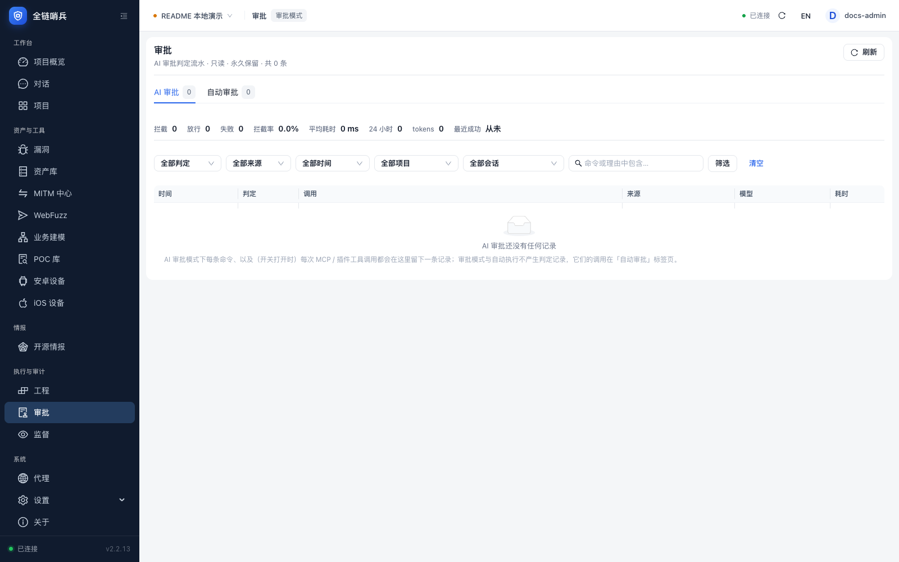

<a id="section-5"></a>

## POC feeds

You can run your own Nuclei POC feed service and add it under Settings → POC feeds. The main use case is n-day testing. A built-in Nuclei POC feature was not originally planned, but custom API routes in frameworks such as Jeecg Boot and RuoYi made it worthwhile.

On your remote server, periodically package all Nuclei POCs into a zip and synchronize it remotely.

You can also synchronize the official Nuclei POCs directly.

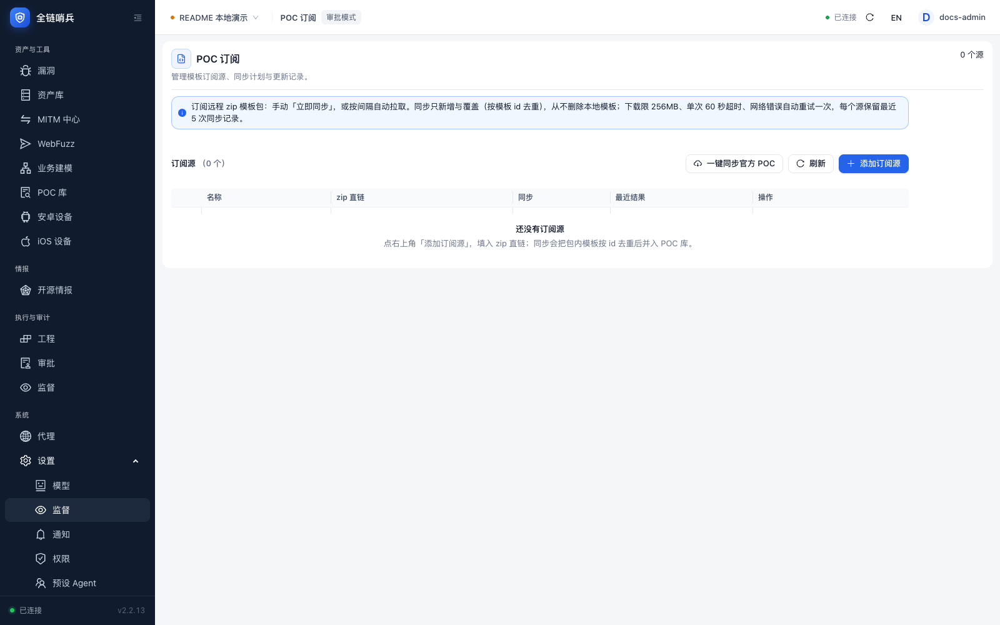

<a id="section-6"></a>

## Plugin center

<a id="section-7"></a>

### How to use it

Full Chain Sentinel abstracts a "plugin" so different plugins can run on different hosts.

For example, if Sentinel is deployed locally but you need public-network capabilities such as a public MSF, copy Sentinel to your VPS and run:

```
./sentinel-web plugin-host --listen 0.0.0.0:7800
```

Then add it under Settings → Plugins.

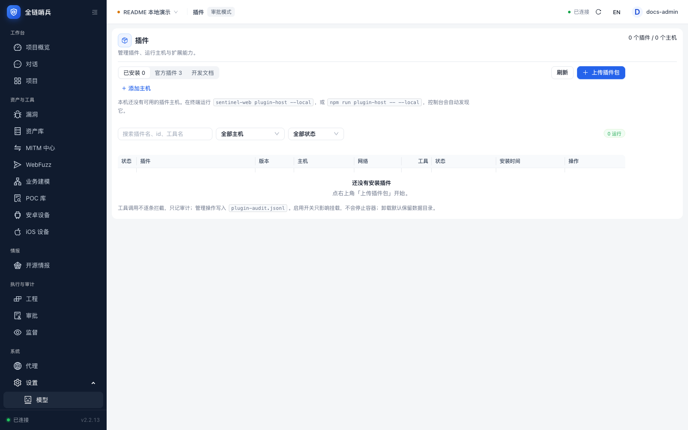

<a id="section-8"></a>

### How to develop plugins

On the plugin development documentation page, copy the full text, give it to an AI, and describe what you need.

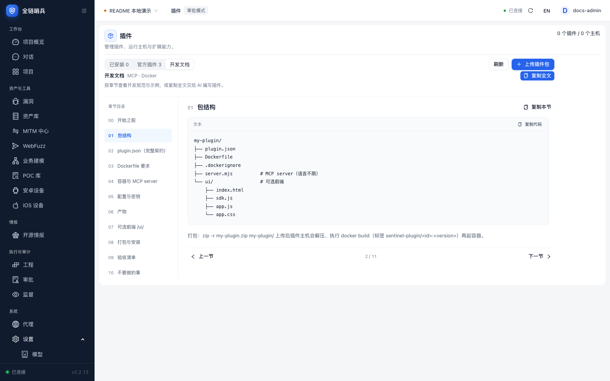

You can also refer to the example plugin "memshell-party" in this repository.

More: [Plugin center](plugin-center.md) · [Plugin authoring](plugin-authoring.md) · [Plugin UI](plugin-ui.md) · [Asset library](asset-library.md).

<a id="section-9"></a>

## MITM and WebFuzz

Start the proxy under MITM Center and configure your test browser or device to use its HTTP proxy address. Install and trust the project CA to inspect HTTPS. Select a captured request and use “Send to WebFuzz” to edit it; import does not send a request. In WebFuzz, confirm Host, HTTPS, and the network route, then send and inspect the response or restore a history entry. See [MITM Center](mitm-center.md) and [WebFuzz](webfuzz.md) (Chinese).

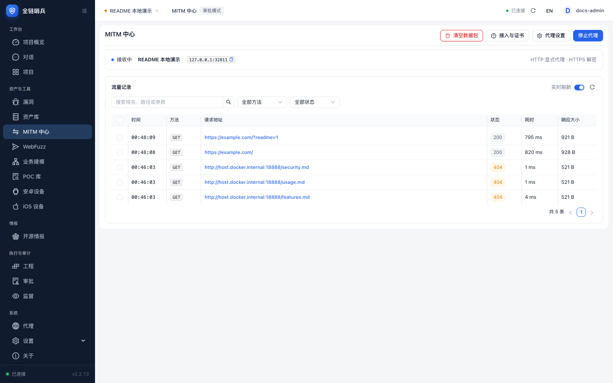

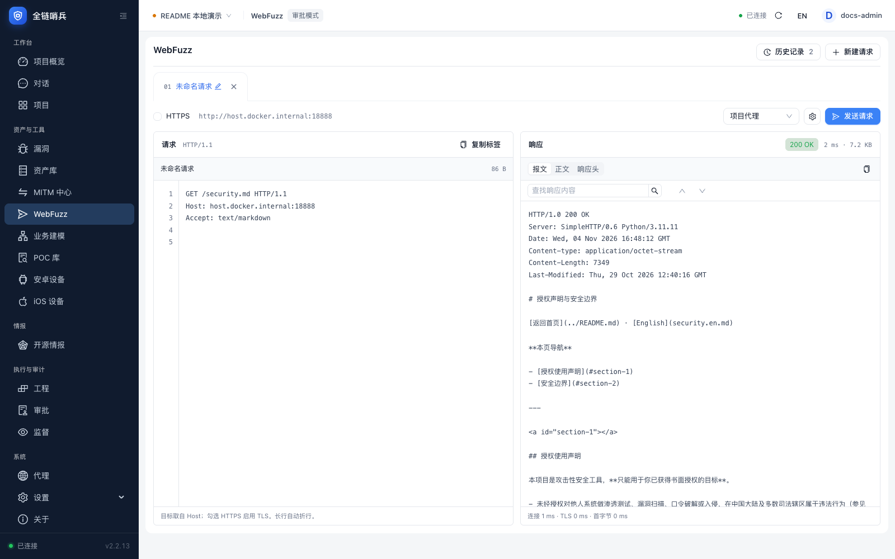

<a id="section-10"></a>

## Open-source intelligence

Open Intelligence → Open-source intel and add repository URLs, branches, and an interval or Cron schedule. A new monitor starts from the branch’s current HEAD. Review security updates in Activity, configure and batch-check repositories in Monitored repositories, and inspect failures in Logs. Use Details, Check, and the more menu for row operations. A GitHub token increases API quota; the capture environment reached the anonymous rate limit, so screenshots show onboarding and configuration rather than invented findings.

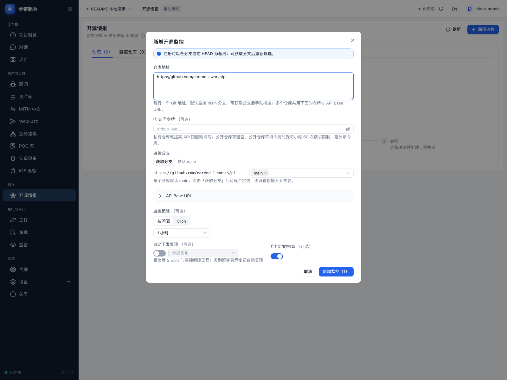

<a id="section-11"></a>

## Models, supervision, and files

Add an endpoint under Settings → Models and assign the main role. Other roles can follow the main model or use a separate endpoint. Enable supervision in the conversation to record progress and advice on the Supervision page. Open Files from the conversation toolbar for uploads, previews, and folder downloads.

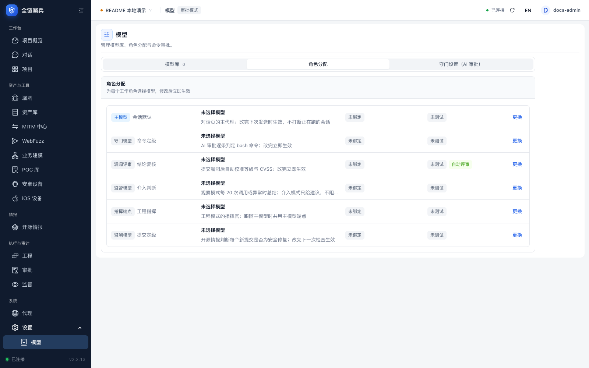

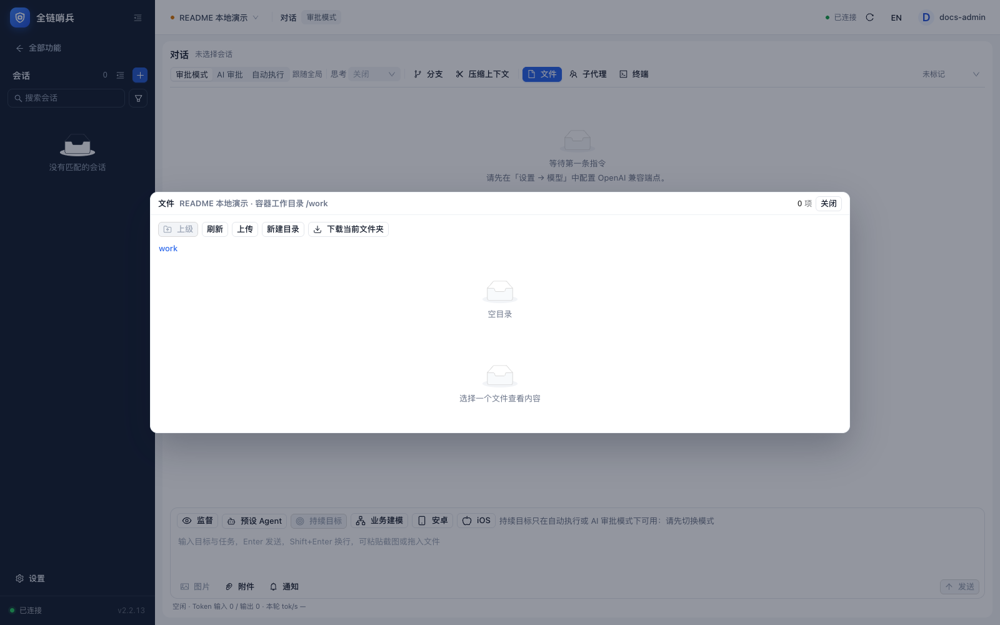
