# 使用指南

[返回首页](../README.md) · [English](usage.en.md)

本页截图来自当前控制台的独立本地项目，空记录和未接入设备均为实际状态；见[截图来源](../images/screenshots/README.md)。

**本页导航**

- [何为全链路？](#section-1)
- [使用](#section-2)
- [工程模式](#section-3)
- [审批](#section-4)
- [关于 POC 订阅](#section-5)
- [插件中心](#section-6)
- [如何使用？](#section-7)
- [如何开发插件？](#section-8)
- [MITM 与 WebFuzz](#section-9)
- [开源情报](#section-10)
- [模型、监督与文件](#section-11)

---

<a id="section-1"></a>

## 何为全链路？

平台覆盖 Web、小程序与 APP 测试。三类客户端的运行环境不同，但可以在同一个项目中整理接口、测试后端、记录资产与漏洞；移动端还提供设备分析工具。

<a id="section-2"></a>

## 使用

使用前先创建项目。

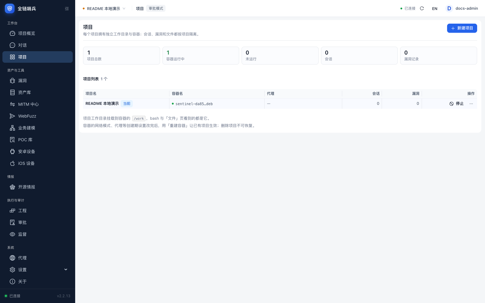

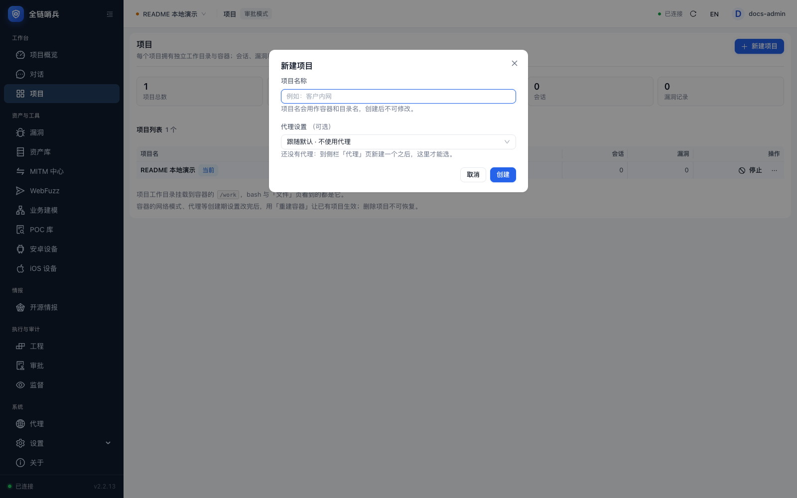

| 场景 | 操作 |
| --- | --- |
| Web 测试 | 在对话输入框说明授权范围、目标和任务。 |
| 小程序测试 | 选择预设 Agent，使用 Tscan 等工具反编译自己的授权测试样本，通过「附件」上传结果。 |
| APP 测试 | 在「安卓设备」接入测试机，安装目标 APP，再启用当前会话的「安卓」工具。iOS 接入见[移动端指南](mobile.md)。 |

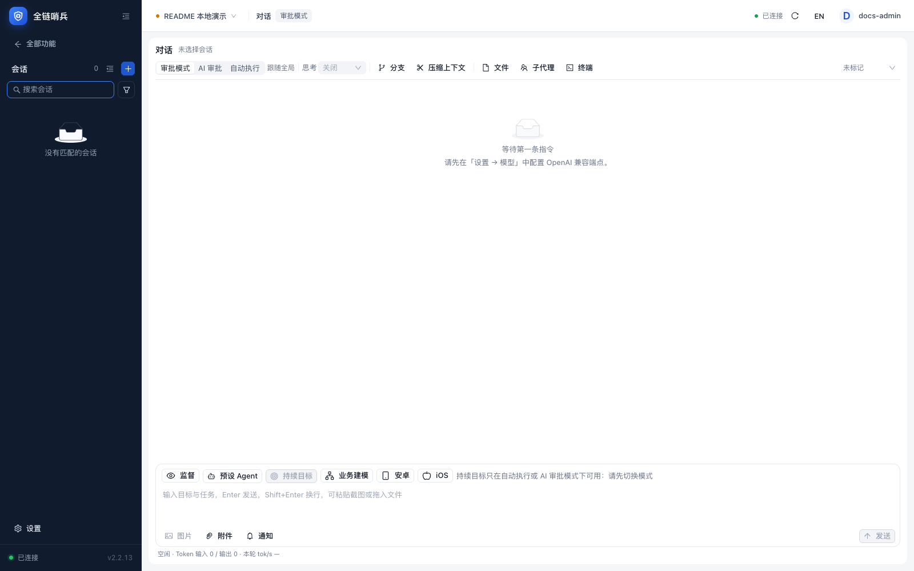

设备工具按会话启用。未开启「安卓」时，当前会话不加载安卓工具和对应提示，减少不相关的上下文。

<a id="section-3"></a>

## 工程模式

工程模式通过指挥官编排多个测试任务，适用于批量测试，目前仍处于测试阶段。

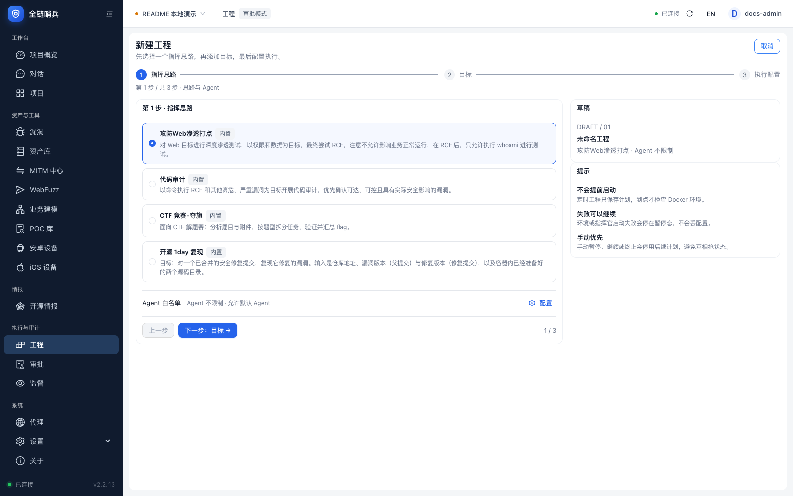

<a id="section-4"></a>

## 审批

在「设置 → 模型」配置独立的守门模型，例如 [Qwen Flash](https://www.qianwenai.com/models/qwen-flash)。选择能满足调用频率的 API；CodingPlan 等套餐的速率限制可能影响审批。

AI 审批对受支持的调用进行判定，失败或超时会放行；覆盖范围见[安全边界](security.md#section-2)。

侧边栏「审批」有两个标签页：「AI 审批」是守门模型的判定流水（判定值、理由、耗时、模型）；「自动审批」是没有人判定的调用流水——自动执行模式、审批模式的人工放行与人工拦截、以及守门没覆盖的工具（read / edit / write、MCP 开关关闭时），每次 bash、MCP 与插件调用都会留一条。两个标签页合起来覆盖每一次调用且只记一次，支持按项目、会话、来源、时间、关键字筛选。

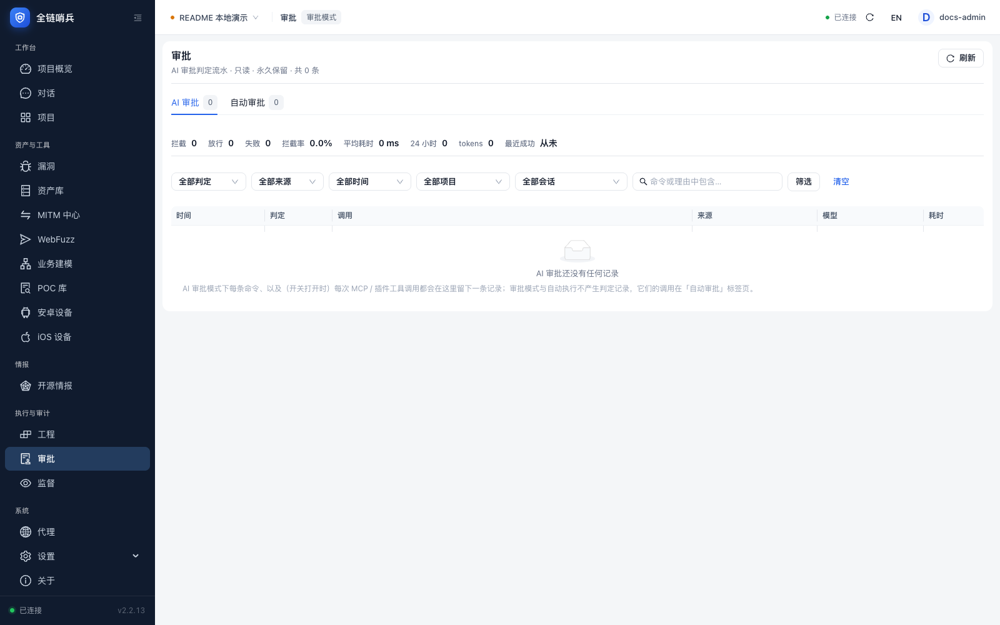

<a id="section-5"></a>

## 关于 POC 订阅

在「设置 → POC 订阅」添加自建订阅，或直接同步 Nuclei 官方 POC。自建订阅可在远程服务器上定时将模板打包成 zip，供平台同步。

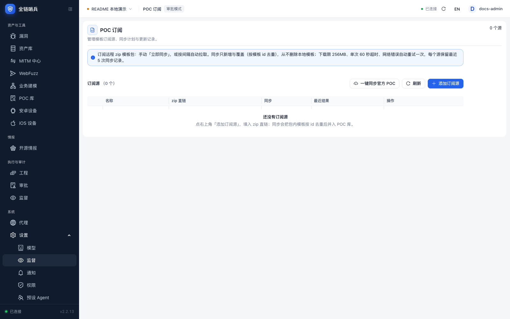

<a id="section-6"></a>

## 插件中心

<a id="section-7"></a>

### 如何使用？

“全链哨兵”抽象出一个“插件概念”可以从不同主机运行不同的插件。

比如你是本机部署的“全链哨兵”，你希望“全链哨兵”有公网能力，比如你想拥有公网的 msf，那么你可以复制一份“全链哨兵”到你的 VPS，并且执行：

```
./sentinel-web plugin-host --listen 0.0.0.0:7800
```

在设置->插件,添加即可。

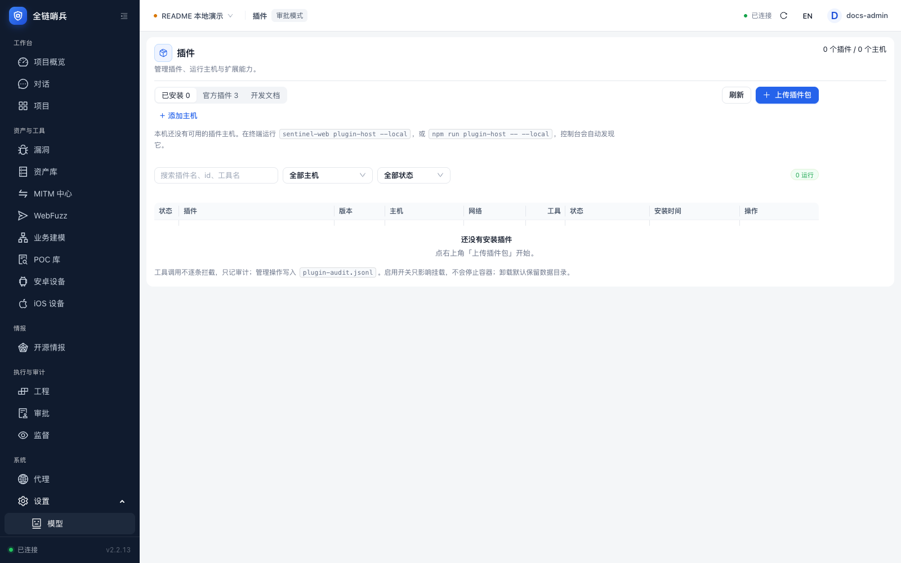

<a id="section-8"></a>

### 如何开发插件？

在插件开发文档页面复制完整规范，可交给 AI 辅助开发，并说明插件需求。

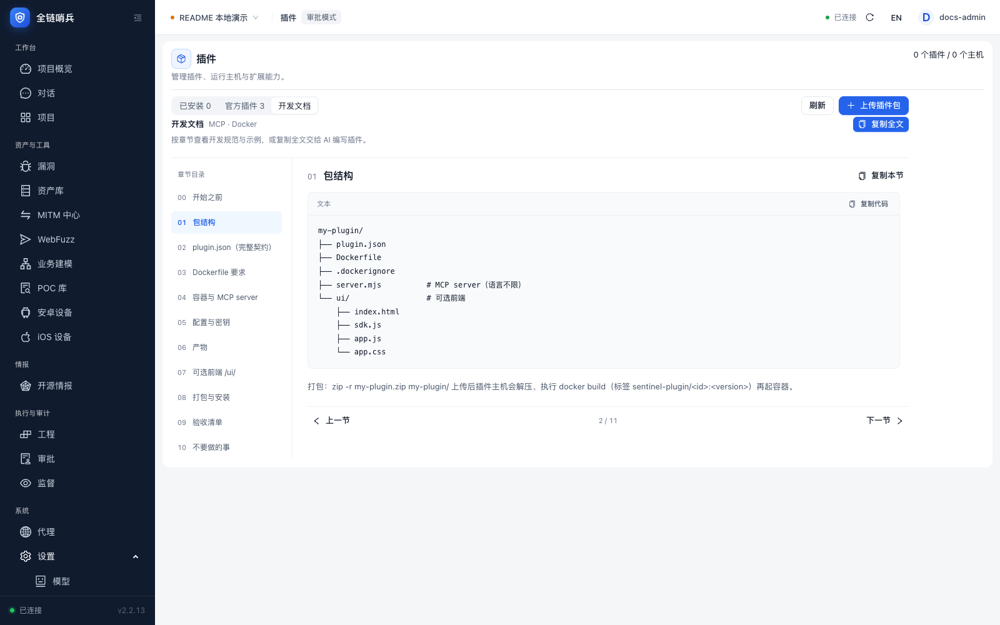

也可参考仓库提供的「memshell-party」示例插件。

详细说明：[插件中心](plugin-center.md) · [插件开发](plugin-authoring.md) · [插件前端](plugin-ui.md) · [资产库](asset-library.md)。

<a id="section-9"></a>

## MITM 与 WebFuzz

在「MITM 中心」启动代理，为测试浏览器或设备配置页面显示的 HTTP 代理地址。解密 HTTPS 时安装并信任当前项目 CA。打开流量详情，点「发送到 WebFuzz」编辑请求；导入不会自动发送。在 WebFuzz 确认 Host、HTTPS 与网络出口后发包，检查响应或恢复历史记录。详见 [MITM 中心](mitm-center.md)与 [WebFuzz](webfuzz.md)。

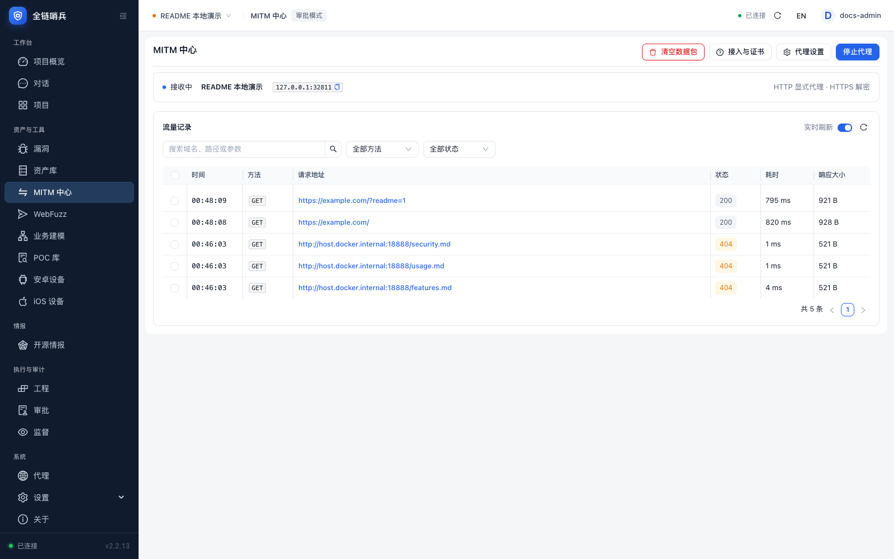

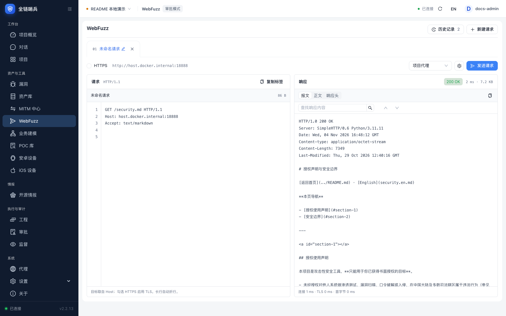

<a id="section-10"></a>

## 开源情报

打开「情报 → 开源情报」，新增仓库地址、分支和间隔或 Cron 策略。注册以分支当前 HEAD 为基线；在「动态」处理安全更新，在「监控仓库」筛选和批量检查，在「日志」回溯失败。行内使用「详情」「检查」和更多菜单执行操作。GitHub 令牌可提高 API 配额；截图环境遇到匿名限流，因此展示首次使用与配置表单，不展示编造的发现结果。

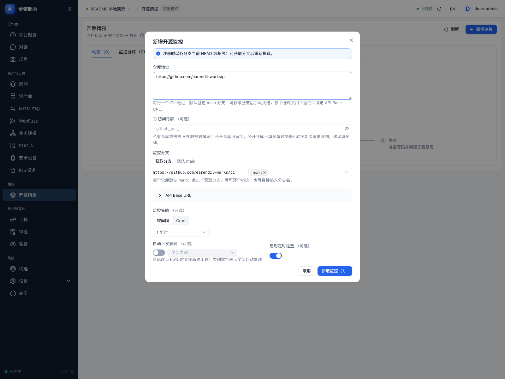

<a id="section-11"></a>

## 模型、监督与文件

在「设置 → 模型」添加端点并分配主模型，其他角色可跟随主模型或指定独立端点。对话输入区开启「监督」后，可在监督页查看进度与建议。对话工具栏的「文件」提供上传、预览和目录打包下载。

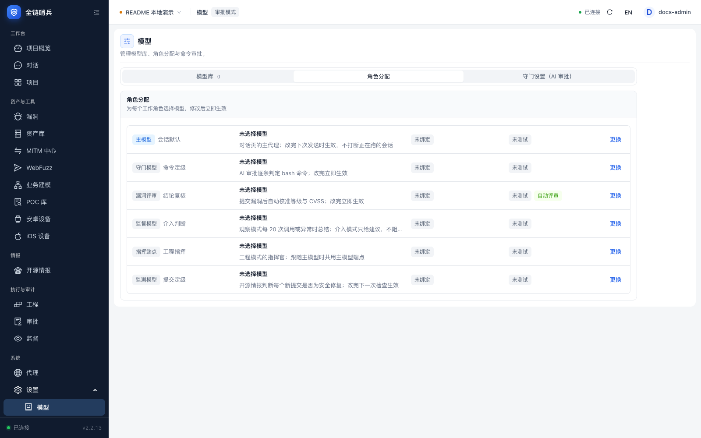

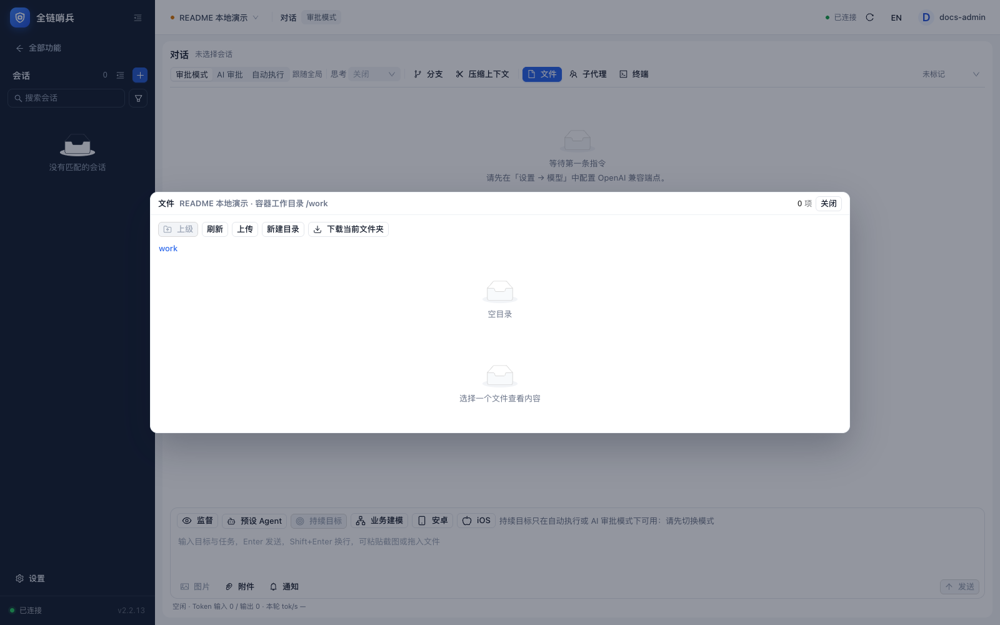
